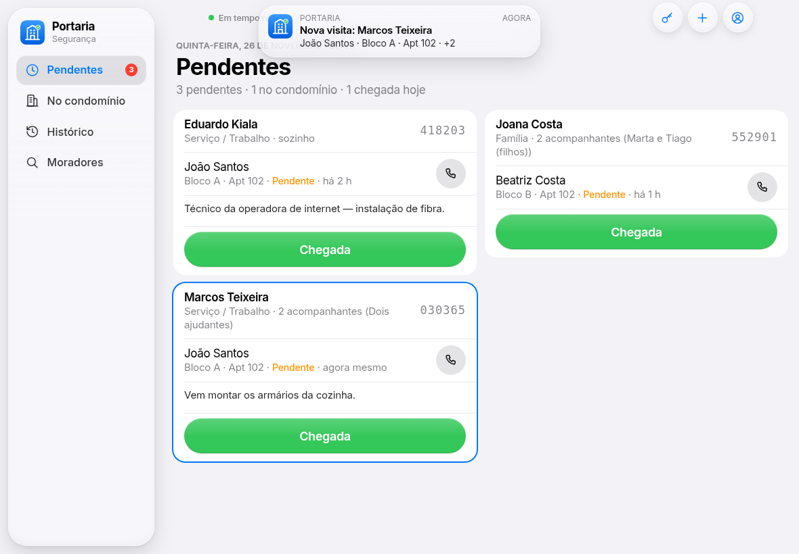
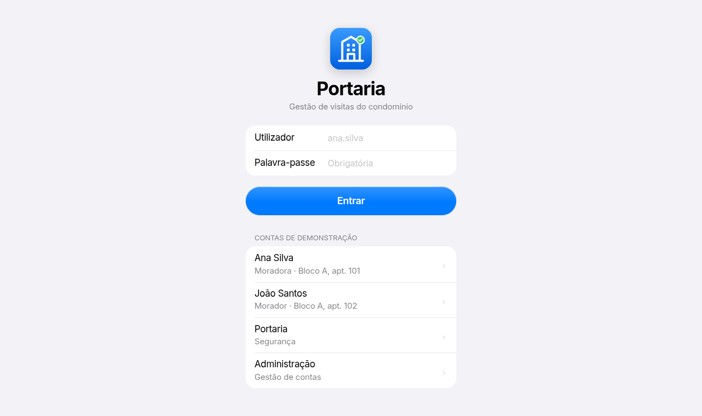
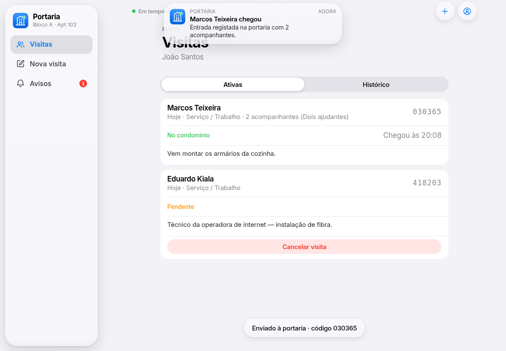
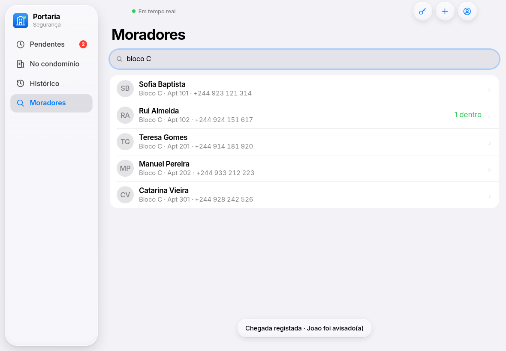
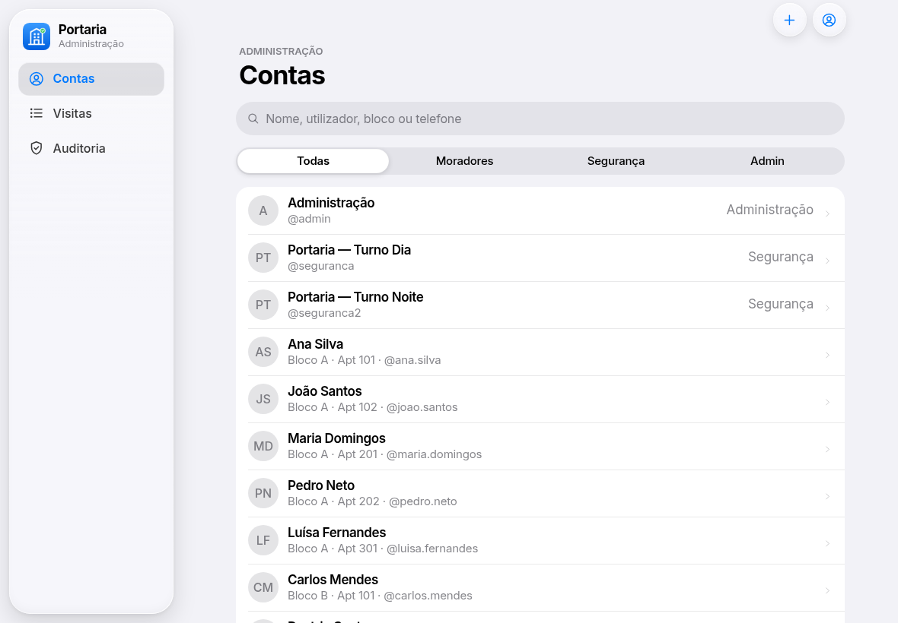
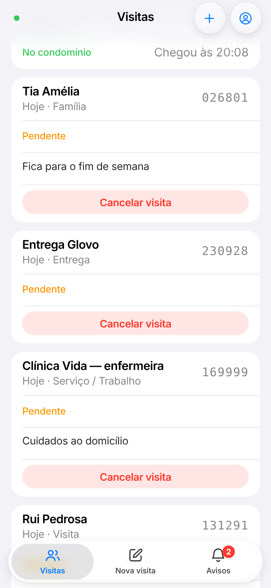
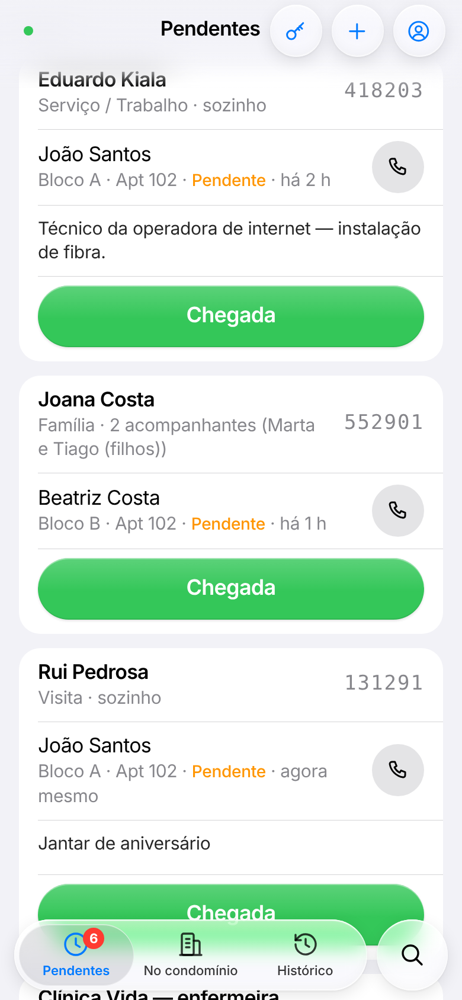
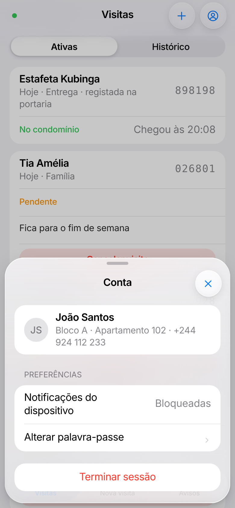
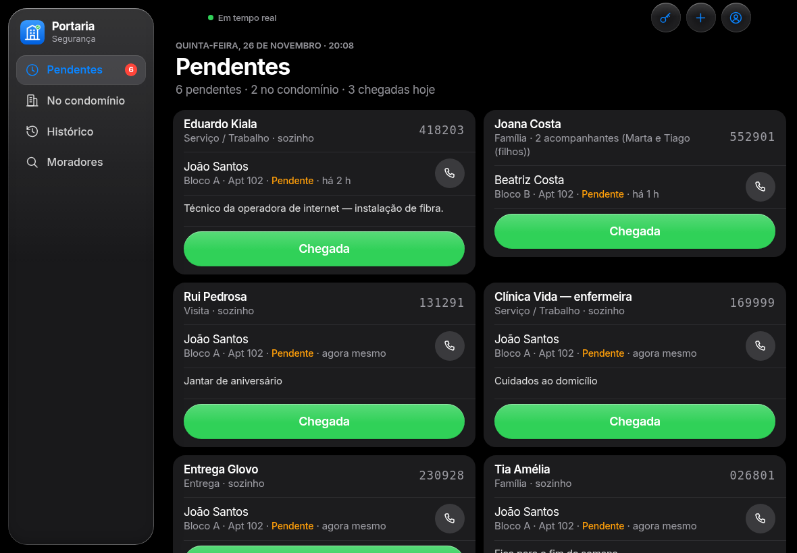

# 🏢 Portaria Digital — Gestão de Visitas do Condomínio

Sistema web para condomínios: o **morador** avisa a portaria das visitas do dia, o **segurança** recebe o aviso **no mesmo instante**, carrega em **Chegada** quando a pessoa aparece e o morador é **notificado na hora**.

Funciona no telemóvel (moradores), no tablet (portaria) e no computador (administração), e pode ser instalado como app (PWA).



---

## ✨ Funcionalidades

### Painel do Morador (`/morador`)
- Registar visita: **nome do visitante**, **se vem acompanhado** (quantas pessoas e quem), **motivo** (visita, serviço/trabalho, entrega, família, outro), **data** (hoje, amanhã ou outra) e **detalhes opcionais** (ex.: "vem fazer a manutenção do ar condicionado").
- Botão **Enviar**: a visita aparece de imediato no painel da portaria (tempo real, sem recarregar).
- Cada visita tem um **código de acesso de 6 dígitos** que pode partilhar com o visitante.
- Lista das visitas **ativas** (pendentes / no condomínio) e **histórico**; cancelar uma visita pendente.
- **Avisos em tempo real**: banner no ecrã + contador + lista de avisos quando o segurança regista a **chegada** ou a **saída**.
- **Notificações do sistema / Web Push** (opcional, o morador ativa com um toque), mesmo com a app em segundo plano.
- Folha **Conta**: alterar palavra-passe, ativar notificações, terminar sessão.
- **Visitante sem aviso**: quando alguém aparece na portaria sem estar registado, o morador recebe um pedido e **autoriza ou recusa** a entrada.

### Painel do Segurança (`/seguranca`)
- Lista **ao vivo** das visitas pendentes de hoje, com botão **Chegada** (o morador é notificado no momento).
- Separador **No condomínio**: quem está dentro agora, com botão **Registar saída**.
- **Pesquisar moradores** (botão no topo ou tecla `/`): por nome, bloco/apartamento (`B 201`, `C102`, `bloco A`) ou telefone; ligar com um toque.
- **Verificar código de acesso** do visitante.
- **Visitante sem aviso**: regista e pede autorização ao morador.
- **Histórico** com filtros (texto, datas, estado).
- Contadores: pendentes hoje, no condomínio, chegadas hoje.

### Administração (`/admin`)
- Gerir contas (moradores, seguranças, administradores): criar, editar, repor palavra-passe, desativar.
- Histórico completo de visitas com filtros.
- **Registo de auditoria** de todas as ações (quem fez o quê e quando), em hora de Luanda.

### Técnico
- Backend real: **Node.js + Express 5 + SQLite** (better-sqlite3, modo WAL).
- **Tempo real com Server-Sent Events** (reconexão automática e ressincronização).
- **Autenticação** com sessão JWT em cookie `httpOnly` + papéis (`morador`, `seguranca`, `admin`); palavras-passe com bcrypt; limite de tentativas de login.
- **Web Push** (VAPID) + Notification API + notificações dentro da app.
- **PWA**: manifest + service worker (instalável no ecrã inicial, shell disponível offline).
- Cabeçalhos de segurança (Helmet, CSP), validação no servidor, horas em **Africa/Luanda**.
- Interface sem frameworks nem build: HTML + CSS + JavaScript (módulos ES), rápida em telemóveis modestos.
- Testes automáticos: API (`node:test` + supertest) e ponta-a-ponta (Playwright).

---

## 🔑 Contas de demonstração

| Papel | Utilizador | Palavra-passe |
|---|---|---|
| Administração | `admin` | `admin123` |
| Segurança (turno dia) | `seguranca` | `seguranca123` |
| Segurança (turno noite) | `seguranca2` | `seguranca123` |
| Moradores (15) | `ana.silva`, `joao.santos`, `maria.domingos`, `pedro.neto`, `luisa.fernandes`, `carlos.mendes`, `beatriz.costa`, `antonio.lopes`, `helena.cardoso`, `miguel.tavares`, `sofia.baptista`, `rui.almeida`, `teresa.gomes`, `manuel.pereira`, `catarina.vieira` | `morador123` |

Os moradores estão nos blocos A, B e C (apartamentos 101–301). Na página de login há botões para entrar rapidamente com cada conta de demonstração.

> ⚠️ Antes de usar a sério: mude ou apague estas contas no painel de administração e defina `JWT_SECRET`.

---

## 🚀 Correr localmente (um comando)

Requisitos: **Node.js 20 ou superior**.

```bash
npm install && npm start
```

Abra **http://localhost:3000**. Na primeira execução é criada a base de dados `data/condominio.db` com os dados de exemplo.

Outros comandos:

```bash
npm run dev          # recarrega o servidor ao editar ficheiros
npm run seed:reset   # apaga a BD e recria os dados de exemplo
npm test             # testes da API
npx playwright install chromium && npm run test:e2e   # teste ponta-a-ponta + capturas de ecrã
```

Para testar com o telemóvel na mesma rede Wi-Fi: abra `http://IP-DO-COMPUTADOR:3000`.
(As notificações push do sistema exigem HTTPS ou `localhost`; os avisos dentro da app funcionam sempre.)

### Variáveis de ambiente
Veja `.env.example`. As principais: `PORT`, `JWT_SECRET`, `DB_FILE`, `SEED=0` (não criar dados de exemplo), `VAPID_PUBLIC_KEY`/`VAPID_PRIVATE_KEY` (opcional).

---

## ☁️ Publicar online

### Opção A — Docker (VPS, servidor próprio, qualquer cloud)
```bash
docker compose up -d --build
```
Os dados ficam no volume `portaria-data`. Coloque um proxy com HTTPS à frente (Caddy, Nginx ou Traefik). Exemplo com Caddy (`/etc/caddy/Caddyfile`):
```
portaria.seudominio.ao {
  reverse_proxy localhost:3000
}
```
> O Caddy obtém o certificado HTTPS automaticamente. Para SSE funcionar atrás do Nginx, use `proxy_buffering off;`.

### Opção B — Render
1. Publique o código no GitHub (ver abaixo).
2. Em [render.com](https://render.com) → **New → Web Service** → escolha o repositório.
3. Runtime **Docker** (usa o `Dockerfile`), ou Node com *Build* `npm install` e *Start* `npm start`.
4. Em **Environment** defina `JWT_SECRET` e `NODE_ENV=production`.
5. Adicione um **Disk** montado em `/app/data` para a base de dados persistir.

### Opção C — Railway
1. [railway.app](https://railway.app) → **New Project → Deploy from GitHub repo**.
2. Defina `JWT_SECRET`, `NODE_ENV=production` e `DB_FILE=/data/condominio.db`.
3. Adicione um **Volume** montado em `/data`.

### Opção D — VPS sem Docker
```bash
git clone https://github.com/SEU-UTILIZADOR/condominio-visitas.git && cd condominio-visitas
npm ci --omit=dev
JWT_SECRET=$(openssl rand -hex 32) NODE_ENV=production npx pm2 start src/server.js --name portaria
```

### Escalar para PostgreSQL
Todo o acesso a dados usa SQL simples em `src/db.js`, `src/services.js` e `src/routes/`. Para Postgres: troque `better-sqlite3` por `pg`, adapte o esquema (`INTEGER PRIMARY KEY AUTOINCREMENT` → `SERIAL`/`IDENTITY`, `strftime(...)` → `now()`), e torne as consultas assíncronas. Para vários servidores em paralelo, troque o `EventHub` (`src/events.js`) por Redis Pub/Sub ou `LISTEN/NOTIFY` do Postgres.

---

## 🐙 Publicar no GitHub (passo a passo)

O projeto já vem com um repositório git local e um commit inicial.

1. Crie uma conta em [github.com](https://github.com) (se ainda não tiver).
2. Clique em **+ → New repository**, nome `condominio-visitas`, **sem** README/licença/.gitignore (já existem), e **Create repository**.
3. No terminal, dentro da pasta do projeto:
   ```bash
   git remote add origin https://github.com/SEU-UTILIZADOR/condominio-visitas.git
   git branch -M main
   git push -u origin main
   ```
   (O GitHub pede login; use um *Personal Access Token* como palavra-passe, ou a GitHub CLI: `gh auth login` e depois `gh repo create condominio-visitas --private --source=. --push`.)
4. Alterações futuras:
   ```bash
   git add . && git commit -m "Descreva a alteração" && git push
   ```

Se descarregou o ZIP (sem a pasta `.git`): `git init && git add . && git commit -m "Versão inicial"` e siga do passo 2.

---

## 🗂️ Estrutura

```
condominio-visitas/
├── src/
│   ├── server.js          # arranque do servidor
│   ├── app.js             # Express: middlewares, rotas, SSE, ficheiros estáticos
│   ├── db.js              # esquema SQLite e ligação
│   ├── seed.js            # dados de exemplo (npm run seed / seed:reset)
│   ├── auth.js            # sessões JWT, papéis, bcrypt
│   ├── events.js          # hub de tempo real (Server-Sent Events)
│   ├── push.js            # Web Push (VAPID)
│   ├── services.js        # notificações, auditoria, códigos de acesso
│   ├── time.js            # fuso horário Africa/Luanda
│   ├── validate.js        # validação de entradas
│   └── routes/            # visits.js (visitas) e other.js (auth, moradores, avisos, push, admin)
├── public/
│   ├── index.html         # login
│   ├── morador.html · seguranca.html · admin.html
│   ├── css/app.css        # design system (Liquid Glass, listas agrupadas)
│   ├── js/                # ui.js (molas, vidro, folhas, avisos), shell.js (navegação), api.js, páginas
│   ├── sw.js · manifest.webmanifest · icons/
├── tests/api.test.js      # testes da API
├── e2e/e2e.mjs            # teste ponta-a-ponta com Playwright
├── docs/screenshots/      # capturas de ecrã
├── Dockerfile · docker-compose.yml · .env.example · LICENSE
```

## 🎨 Design — Liquid Glass (iOS 26 / iPadOS 26)

Todo o desenho segue a skill **apple-design** (repositório `emilkowalski/skills`) e o seu complemento **mobile-native**:

| Princípio da skill | Como está aplicado |
|---|---|
| §12 Materiais: camada funcional translúcida, bordo brilhante, "materializar", nunca vidro sobre vidro | Vidro só na barra de separadores, botões da barra, avisos e folhas; o conteúdo é plano (listas agrupadas). Folhas e avisos materializam com escala + opacidade |
| §12 Efeito de borda de scroll em vez de linhas de 1px | A barra de navegação ganha um véu desfocado ao fazer scroll; o título grande colapsa para um título central |
| §12/§14 Reduzir transparência / contraste | `prefers-reduced-transparency` → superfícies sólidas; `prefers-contrast: more` → sem vidro, com contorno |
| §1 Resposta no pointer-down; §3-§6 molas, velocidade, projeção de momento | Botões reagem ao toque; indicador dos separadores, segmentos, folhas e avisos usam molas interrompíveis; a folha fecha com o momento do gesto |
| §14 Reduzir movimento | Molas substituídas por fades curtos |
| §15 Tipografia | Fonte do sistema, *tracking* e *leading* por tamanho, `rem`, números tabulares |
| mobile-native | `viewport-fit=cover` + safe-areas, `100dvh`, campos ≥16px, `touch-action`, `user-select` só em controlos, hover só com `(hover: hover)`, `theme-color` por esquema |
| ui-cheatsheet | Datas absolutas após uma semana, plurais com `Intl.PluralRules`, `tabular-nums` |

**O vidro**, camada a camada (`public/css/app.css` + `installGlass()` em `public/js/ui.js`): desfoque + saturação do fundo → preenchimento translúcido com **tinta adaptativa** (mede a cor do que está por baixo ao fazer scroll) → brilho interior e sombra de contacto → **aro especular** de 1px → brilho de superfície com **realce que segue o dedo/rato** → **lente de refração** (filtro SVG com `feDisplacementMap` no `backdrop-filter`, apenas Chromium; Safari/Firefox ficam com o vidro desfocado, sem lente).

Estrutura nativa: no telemóvel, barra de separadores flutuante em cápsula (com o separador *Moradores* destacado, como a pesquisa do iOS 26); no tablet/computador, barra lateral flutuante. Títulos grandes que colapsam, controlos segmentados, listas *inset grouped*, folhas arrastáveis, avisos no estilo das notificações do iOS e modo escuro automático.

## 📸 Capturas

| | |
|---|---|
|  |  |
|  |  |
|  |  |
|  |  |

## 📄 Licença

MIT — veja [LICENSE](LICENSE).
